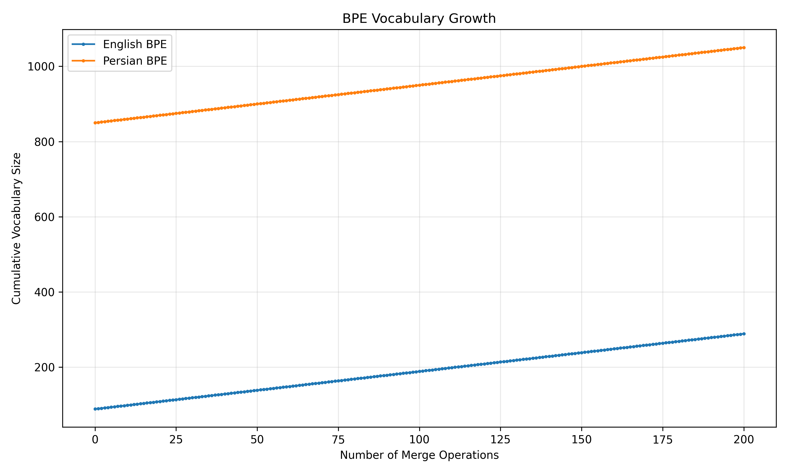
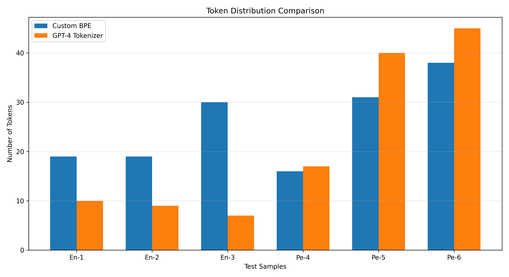

# BPE Tokenizer Implementation and Comparison with GPT-4


## 1. Project Overview

The goal of this project is to implement the **Byte Pair Encoding (BPE)** algorithm from scratch and evaluate its performance on Persian and English text datasets.

Two independent BPE tokenizers are trained, one for each language. Their vocabulary sizes and tokenization results are then compared with the tokenizer used by GPT-4.

The project also investigates vocabulary growth during training and analyzes the differences between tokenization results across the two languages.

## 2. Project Objectives

- Implement the BPE algorithm using Python.
- Prepare Persian and English text corpora.
- Train separate tokenizers for both languages.
- Analyze vocabulary growth during the merging process.
- Compare the number of generated tokens with the GPT-4 tokenizer.
- Evaluate the results and discuss implementation limitations.

## 3. Project Structure

```text
4051406424_HW1/
│
├── bpe.py
├── test_bpe.py
│
├── prepare_corpus_en.py
├── prepare_corpus_fa.py
│
├── train_bpe_en.py
├── train_bpe_fa.py
│
├── compare_tokenizers.py
├── generate_plots.py
│
├── data/
│   ├── corpus_en.jsonl
│   └── corpus_fa.jsonl
│
├── results/
│   ├── vocab_en.json
│   ├── vocab_fa.json
│   ├── comparison_table.csv
│   │
│   └── plots/
│       ├── vocab_growth.png
│       └── token_distribution.png
│
├── report.pdf
└── README.md
```

## 4. Technologies and Libraries

| Technology | Purpose |
|---|---|
| Python 3.10 | Main programming language |
| Collections | Frequency counting |
| Regular Expressions | Text preprocessing |
| JSON / JSONL | Data and vocabulary storage |
| Pandas | Data management |
| Matplotlib | Plot generation |
| Tiktoken | GPT-4 tokenizer comparison |
| Pytest | Unit testing |

## 5. Datasets

Two independent text datasets were used in this project.

### 5.1. English Dataset

The English corpus was prepared using the TinyStories dataset. The first 5,000 stories were selected for the experiments.

- Number of documents: 5,000
- Total characters: 4,151,704
- Average characters per document: 830.34

### 5.2. Persian Dataset

The Persian corpus was obtained from the Persian Wikipedia dataset, `codersan/Persian-Wikipedia-Corpus`.

A total of 5,000 articles were selected and processed.

- Number of documents: 5,000
- Total characters: 27,576,458
- Average characters per document: 5,515.29

Both prepared corpora are stored in JSONL format in the `data/` directory.

## 6. BPE Implementation

The BPE algorithm is implemented independently in `bpe.py`, without relying on an existing BPE implementation.

The training process starts by splitting words into individual characters. The algorithm then identifies the most frequent adjacent symbol pair and merges the pair into a new symbol.

The main training steps are:

1. Load and preprocess the input text.
2. Count word and symbol frequencies.
3. Calculate the frequency of adjacent symbol pairs.
4. Select the most frequent pair.
5. Merge the selected pair and update the vocabulary.
6. Repeat the process until the specified number of merges is reached or no eligible pair remains.
7. Apply the learned merges during tokenization.

This implementation uses **Character-level BPE**. Whitespace characters are also preserved during tokenization to ensure that decoding can reconstruct the original text.

## 7. Training Configuration

The following configuration was used for both languages:

| Parameter | Value |
|---|---:|
| Number of merges | 200 |
| Minimum pair frequency | 2 |
| English documents | 5,000 |
| Persian documents | 5,000 |

Training time:

| Language | Training Time |
|---|---:|
| English | 14.66 seconds |
| Persian | 266.34 seconds |

## 8. Installation and Execution

### 8.1. Create a Virtual Environment

Open a terminal in the project directory and run:

```bash
python -m venv .venv
```

Activate the environment on Windows:

```bash
.venv\Scripts\activate
```

### 8.2. Install Dependencies

```bash
pip install numpy pandas matplotlib tiktoken tqdm datasets pytest
```

### 8.3. Prepare the Datasets

Prepare the English corpus:

```bash
python prepare_corpus_en.py
```

Prepare the Persian corpus:

```bash
python prepare_corpus_fa.py
```

The resulting files will be saved in the `data/` directory.

### 8.4. Train the Tokenizers

Train the English tokenizer:

```bash
python train_bpe_en.py
```

Train the Persian tokenizer:

```bash
python train_bpe_fa.py
```

The trained vocabularies will be saved in the `results/` directory.

### 8.5. Compare with GPT-4

```bash
python compare_tokenizers.py
```

This script compares the custom BPE tokenizers with the `cl100k_base` tokenizer.

### 8.6. Generate Plots

```bash
python generate_plots.py
```

The generated plots are saved in:

```text
results/plots/
```

### 8.7. Run Unit Tests

```bash
pytest -v
```

## 9. Experimental Results

After training with 200 merges, the final vocabulary sizes were:

| Language | Final Vocabulary Size |
|---|---:|
| English | 287 |
| Persian | 1,050 |

### 9.1. Comparison with GPT-4 Tokenizer

The `cl100k_base` encoding was used as the GPT-4 tokenizer baseline.

The average number of tokens across three test samples for each language is shown below:

| Language | Custom BPE | GPT-4 |
|---|---:|---:|
| English | 22.67 | 8.67 |
| Persian | 28.33 | 34.00 |

For the tested English samples, the custom tokenizer generated more tokens on average than GPT-4.

For the tested Persian samples, the custom tokenizer generated fewer tokens on average.

These results are limited to the selected samples and should not be interpreted as a general performance ranking between the tokenizers.

## 10. Visualizations

### 10.1. Vocabulary Growth

This plot illustrates how the vocabulary size changes throughout the BPE merging process.



### 10.2. Token Distribution Comparison

This plot compares the number of tokens generated by the custom BPE implementation and GPT-4 for the selected Persian and English samples.



## 11. Discussion and Limitations

The experimental results demonstrate that BPE tokenization is influenced by language characteristics, corpus composition, and training configuration.

Several limitations should be considered:

- Both datasets contain the same number of documents, but their total character counts are different.
- The Persian corpus is considerably larger than the English corpus.
- The custom implementation uses Character-level BPE, whereas GPT-4's `cl100k_base` tokenizer uses byte-level tokenization and a different preprocessing and merging strategy.
- The comparison is based on only three samples per language. A larger and more diverse evaluation dataset would provide more reliable conclusions.
- The custom implementation uses straightforward Python operations, while Tiktoken is highly optimized. Therefore, execution time comparisons do not directly measure the intrinsic efficiency of the BPE algorithm.

## 12. Conclusion

In this project, the BPE algorithm was implemented from scratch and trained on separate Persian and English datasets.

The resulting tokenizers were evaluated in terms of vocabulary size, vocabulary growth, and tokenization output. Their results were also compared with the GPT-4 tokenizer.

The experiments showed that using the same number of documents and merge operations does not necessarily produce similar vocabulary sizes or tokenization behavior across different languages.

The project provides practical experience with subword tokenization and demonstrates how language characteristics and implementation choices can influence tokenization results.

